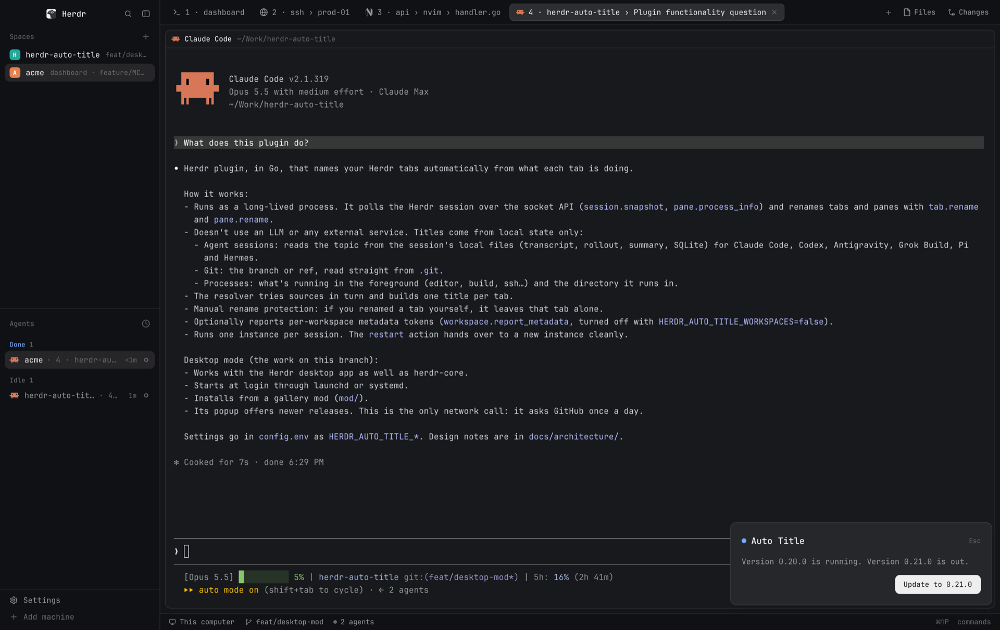

# Auto Title

Names your desktop tabs from what each one is doing: the topic of a Claude
Code, Codex, Pi, Grok, Hermes or Antigravity session, the file open in your
editor, the running build or the Git branch. No LLM, nothing about your tabs
leaves the machine, and a tab you rename yourself keeps your name. The popup,
opened with `cmd-alt-t`, installs [Herdr Auto
Title](https://github.com/kryptamine/herdr-auto-title) with one button and
offers each update.

## Before you add it

The popup is only the installer. The work is done by the `herdr-auto-title`
binary, which `desktop install` has launchd (macOS), the systemd user manager
(Linux) or Task Scheduler (Windows) start at login. The mod **reaches the
network** (GitHub, for the release it belongs to) and **runs programs**: on
Unix, its `install.sh` in a tab of its own, which runs `uname`, `curl`,
`awk`, `shasum` or `sha256sum` and `chmod`, then the downloaded binary only
after its checksum matched. The popup uses `fs/promises` for temporary files
under `appHome()/data` and asks the installed copy for `desktop status`.
The binary writes its own copy and service definition.

On Windows, `install.cmd` prefers Git Bash, including Git installed through a
shim. Without a usable Git Bash it runs `install.ps1` with Windows PowerShell
5.1: `Invoke-WebRequest` downloads and .NET SHA256 checks the binary. A Bash
install failure does not trigger the fallback. Neither route needs Go.
A fixed PowerShell `-Command` reads `LOCALAPPDATA` and checks for the installed copy.
Policy can block the fallback's `.ps1`; CMD reports this instead of leaving
the popup waiting. Install Git for Windows or use a release binary directly
if your policy prevents it. No machine or user execution policy is changed.

The mod has no place in any layout, so it changes none: it opens over the
window and goes with `Esc` or a click elsewhere. Nothing opens it the first
time: its `keys.json` binds `cmd-alt-t`, so merge that into yours. An agent
adding the mod opens it once afterwards with `herdr-app do mod.open --name
auto-title`, so the person sees `Install`. Once installed, the service opens it
by itself when a newer release is out.

There is no button to remove it: run `<copy> desktop uninstall`, with the copy's
path from [Built from](#built-from).

## What you see

A 440×150 card in the window's bottom right corner, 13px from the right and
42px from the bottom: a frameless 445×184 popup, its `at` far past the window,
which the app clamps 8px into the corner; the gaps are `RIGHT_GAP` and
`BOTTOM_GAP` in `main.js`, and changing one changes `mod.json` too. The card: radius 10, a `border`,
a large shadow, `popover` background, 18px padding, 12px gaps, 13px text.
Top to bottom:

- A row: an 8px dot: `done` while the service runs, `dim` when not installed,
  `working` while a button's work runs, `blocked` on an error or when installed
  but not running; "Auto Title", 15px semibold, `foreground`; at the right,
  "Esc", 11px `dim`.
- The status, `muted` (or `blocked` for an error), wrapping:
  - "Checking…" until the copy has answered
  - "Not installed. Tabs keep the names Herdr gives them."
  - "Version 0.21.0 is running and names your tabs."
  - "Version 0.21.0 is running. Version 0.22.0 is out."
  - "Version 0.21.0 is installed but not running.", with the same second
    sentence when a newer release is out
  - "Installing 0.21.0 in a new tab…"
  - the error, as the failing step or the copy said it
- A row of 32px buttons at the right, radius 8, 12px text, `solid` /
  `solid_foreground`, from one table of states:

  | State | Buttons |
  |---|---|
  | not installed | `Install 0.21.0` |
  | installed, running | `Update to 0.21.0` for an older copy, else none |
  | installed, not running | `Update to 0.21.0` for an older copy, else `Start` |
  | the copy cannot answer | `Reinstall 0.21.0` |

  `Update to` names the newer of `VERSION` and the copy's `latest`, and starts
  the copy as it installs it, so it stands in for `Start`.

  No button while one's work runs. A failed button's error replaces the status
  text and keeps the state's buttons.

## How it behaves

- **The mod installs its own release**, `VERSION` in `service.js`, or a newer
  one the service found: `desktop status` reports it as `latest`, and the
  service opens this popup once when it finds one.
- **Install / Update / Reinstall** opens a tab named "Auto Title install" that runs the
  mod's `install.sh` (Windows: `install.cmd`): it finds the asset for this machine
  (`herdr-auto-title-<macos|linux|windows>-<amd64|arm64>`, with `.exe` on Windows), downloads it with a progress
  bar and `SHA256SUMS` from `releases/download/v<VERSION>/` into a unique
  folder under `appHome()/data`, compares the checksums and runs `<binary> desktop install`. It writes
  `0`, or `1` and why, to `status` in that folder; the popup reads it every
  second, for up to ten minutes, and removes the folder after. On a failure the
  script deletes the download before publishing status, then the tab says
  why and waits for Enter. The script closes its own tab when it exits.
  On Unix, closing the tab or Ctrl+C writes "The install was stopped." at once,
  until a status is written; after that a signal only ends the script, since
  the script's own `hc kill` hangs it up too.
  On Windows, killing the whole terminal can bypass PowerShell cleanup; the
  popup then reports its ten-minute timeout and removes its temporary folder.
- **Start** runs `<copy> desktop install`: the copy installs itself again, which
  starts its service, with no download and its own version kept.
- **A newer copy is never downgraded.** `Update` shows only for an older one.
- **Status**: no copy means not installed; otherwise `<copy> desktop status`
  prints `{"version": …, "running": …, "latest": …}`, which the binary answers from the same
  code that set the service up. A copy that cannot answer is shown as the
  error it gave, never as not installed. Read when the popup opens and after
  every button.

## Built from

- One mod, `mods/auto-title/`: `mod.json` (`"place": "none"`, a frameless
  445×184 popup `overlay` with `at` far past the window, as above),
  `main.js` (the popup: its state, the status and buttons that state gives,
  and the render), `service.js` (everything done to the machine: `VERSION`, a
  table of where each OS keeps the copy, then `installed`, `older`, `install`,
  `newest` and `start`) and `install.sh` (the download, the
  checksum and `desktop install`, run as `sh <appHome>/mods/auto-title/install.sh
  <version> <dir>`). Windows uses `cmd.exe /d /c install.cmd <version> <dir>` with the mod
  folder as its working directory. CMD selects Git Bash or the PowerShell
  fallback, and forwards the installer exit code.
  No layout, no art.
- `keys.json` beside `mods/`: `{ "global": { "cmd-alt-t": "mod.open:auto-title" } }`.
- `herdr`: `exec`, `run` (`terminal.open`), `appHome`, `home`, `theme`.
  `fs/promises`: staging and status files. `crypto`: `randomUUID`.
  `os`: `platform`. `gpui-base`: `h_flex`, `v_flex`. The wait between status
  reads is `cx.sleep`.
- The copy lives where `desktop install` puts it:
  `~/Library/Application Support/herdr-auto-title/bin/herdr-auto-title` on
  macOS, `${XDG_DATA_HOME:-~/.local/share}/herdr-auto-title/herdr-auto-title`
  on Linux, and `%LOCALAPPDATA%\herdr-auto-title\bin\herdr-auto-title.exe`
  on Windows (falling back to `~/AppData/Local` if that variable is not absolute).

## Watch out

- **`exec` defaults to 30s**, and a download can take longer, so the install runs
  in a terminal, where nothing stops it, rather than through `exec`.
- **`run` returns nothing**, so the popup cannot follow the tab it opened; the
  status file is how the script reports back.
- **`terminal.open` leaves a shell behind**: it runs `argv` as `zsh -lic '"$@";
  exec "$0" -li'`, so the tab outlives the script. The script closes it with
  `hc kill "$HC_TERMINAL_ID"`, the address herdr-core gives every terminal.
- **`fetch` reads text only**, so the binary is downloaded with `curl`.
- **`window()` is null under `herdr-app check`**; the platform comes from `os`.
- **A popup is not a block.** Herdr 0.1.13 docked no `"place": "bottom"` mod
  into its own `main` layout, which takes no structure, so a strip would need a
  layout of the person's own. The popup needs none.
- **The popup can close mid-install**, on `Esc` or a click elsewhere, and its
  copy goes with it. So `install.sh` deletes its own download, and the popup
  reads the copy afresh whenever it opens again. Its small status directory
  remains when the popup cannot finish cleanup.
- **Windows chooses the native CPU**, using `PROCESSOR_ARCHITEW6432` before
  `PROCESSOR_ARCHITECTURE`, so an emulated shell still downloads ARM64 on ARM64.
  The installer removes its download before waiting for Enter after a failure.
- **Downloads go under `appHome()/data`, never under `mods/`**: a file saved there
  reloads every copy of the mod.
- **`service.js` names `install.sh` by its path under `mods/auto-title/`**: a
  copy added under another name has to rename that path too.

## Done when

- `herdr-app check mods/auto-title` passes.
- Not installed: the popup shows `Install <VERSION>`.
- `Install` opens a tab that downloads with a progress bar, and the popup ends
  on "Version <VERSION> is running and names your tabs."; the tab labels
  change within a second.
- A release that cannot be found leaves the popup on "The download of
  <VERSION> failed.", and the tab on the same line, waiting for Enter.
- `cmd-alt-t` opens the popup and again closes it, as does `Esc`; no layout
  changes when the mod is added.
- Closing the popup mid-install leaves the install running in its tab, no
  download behind once it ends, and the popup opened again shows the result.
- With the service stopped, the popup offers `Start`, which ends on "Version
  <VERSION> is running and names your tabs." with no tab opened.
- `<copy> desktop uninstall`, run by hand, leaves the popup on "Not
  installed.", and nothing of the service: `launchctl print` fails, the plist
  and the copy are gone.
